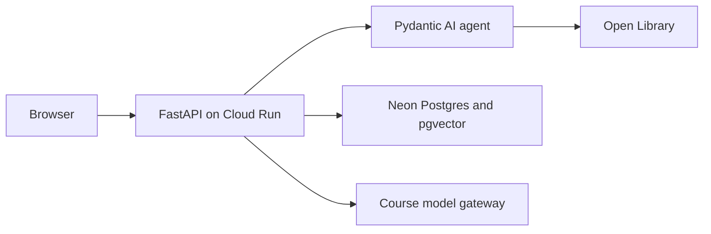

# Book finder

A book club member describes a book they have in mind, or a kind of book they want, and the finder names up to three books that Open Library confirms. They edit the summary and save a nomination they can reopen later. They can also search the saved descriptions by meaning.

The public Cloud Run URL goes here after deploy. The three-minute demo goes here after it is recorded.

## How a save moves



The browser posts the conversation to FastAPI. The agent names likely books. Open Library has to return the same book before a card is shown, and the card shows that record. A summary is drafted from the Open Library description when that description is usable. Save writes the session, the book, and the nomination in Postgres. Search by meaning embeds the stored descriptions and orders them with pgvector.

## Run it locally

Copy `.env.example` to `.env` and fill in `LLM_API_GATEWAY`, `LLM_API_TOKEN`, and `DATABASE_URL`. Then:

```bash
uv run fastapi dev app/main.py
```

## Checks

```bash
uv run ruff check
uv run mypy
uv run pytest
```

The model-quality run is separate from pytest:

```bash
uv run python -m evals.run_finder
uv run python -m evals.run_finder --model gemini-3.5-flash
```

The write-up is `docs/EVALUATIONS.md`.

## Deploy

A push to `main` runs `.github/workflows/deploy.yml`, which deploys this image to Cloud Run in `us-east1` with a maximum of 2 instances. The workflow reads `GCP_WORKLOAD_IDENTITY_PROVIDER` and `GCP_SERVICE_ACCOUNT` from GitHub secrets, and the service reads `DATABASE_URL`, `LLM_API_TOKEN`, and `LLM_API_GATEWAY` from Secret Manager.

Create the app login in `db/app_role.sql` as the database owner, put that role's connection string in the `DATABASE_URL` secret, and set a spending limit on the model key before sharing the public URL. Cloud Run's instance cap is the other limit.

`LOGFIRE_TOKEN` is optional. When it is set, agent calls are sent to Logfire.
