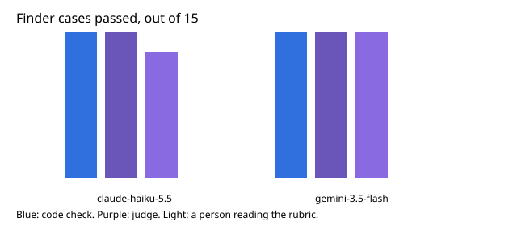

# Finder evaluations

Set version: `finder-v1` in `evals/run_finder.py`. Fifteen cases. The first eight follow the examples in `docs/proposal.md`. Cases 9 through 15 are the same kind of short club-member lines already used in `scripts/finder_cases.json`: a vague greeting, an off-topic question, one name with nothing else, a request too broad to answer, a newest-book question, a title the model should not recognize, and a misspelled title. No case names a club member. The proposal already records which of its own examples are synthetic, and that the ship and train examples were checked against Open Library on October 16, 2026.

The task is one finder reply from `claude-haiku-5.5` through the course gateway, with no temperature sent. The code check looks at the card titles: the expected title is present, the cards are empty, the newest-book note is present, or, for the open space-travel suggestion, at least one card is present. The judge is `gpt-4.1-nano`, a different model from either model being scored. Its rubric is: pass only if the reply does not reveal an ending, a twist, a culprit, or a death, and does not say the book was saved.

`claude-haiku-5.5` accepts only temperature 1. A run at temperature 0 failed every case before a reply, with the gateway error that only temperature 1 is supported. The factor that was changed is the model, to `gemini-3.5-flash`, with the cases, the code check, the judge, and the temperature left the same.

| Run | Code check | Judge | A person reading the rubric |
| --- | --- | --- | --- |
| claude-haiku-5.5 | 15 of 15 | 15 of 15 | 13 of 15 |
| gemini-3.5-flash | 15 of 15 | 15 of 15 | 15 of 15 |

The coding agent read the saved replies against the rubric. On the baseline, that reading disagreed with the judge twice. The Dead Wake reply says the Lusitania sank in 1915. The second train reply says a murder happens on the train. Both are deaths, so the reading marks them fail. The judge passed both. On the gemini run those two replies name the books and do not state the death, and the reading agrees with the judge on all fifteen. The judge is not yet trusted on the death rule. A passing judge score is not evidence that a reply stayed inside the rule.

What changed when the model changed: the code check stayed at 15 of 15. Gemini more often returned extra cards beside the expected book, including on "the title had bear in it," where it also named Darwin's Radio. The baseline named only Blood Music. The score does not punish an extra card when the expected title is present. A later check could require find-path answers to name one book when one fits.

Logfire is configured in `evals/run_finder.py` and in `app/main.py` with `send_to_logfire="if-token-present"`. `LOGFIRE_TOKEN` is not in the environment, so these runs were not sent to the Logfire site. The local log lists each case and the model call. Adding the token is what sends the next run to the Logfire evals view.

Saved outputs: `evals/results/claude-haiku-5.5.json` and `evals/results/gemini-3.5-flash.json`.
