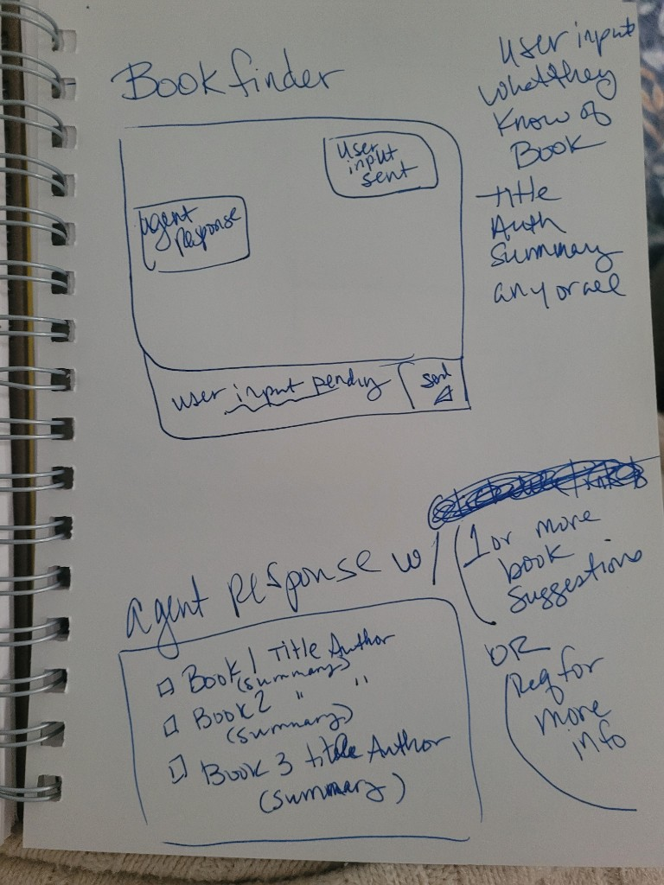
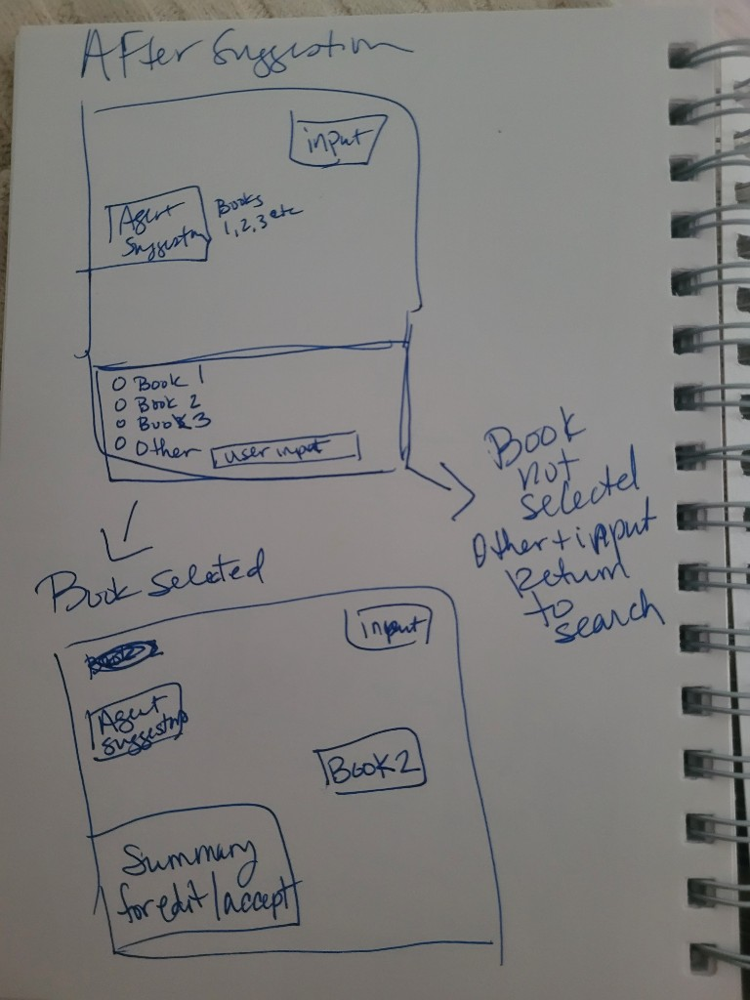
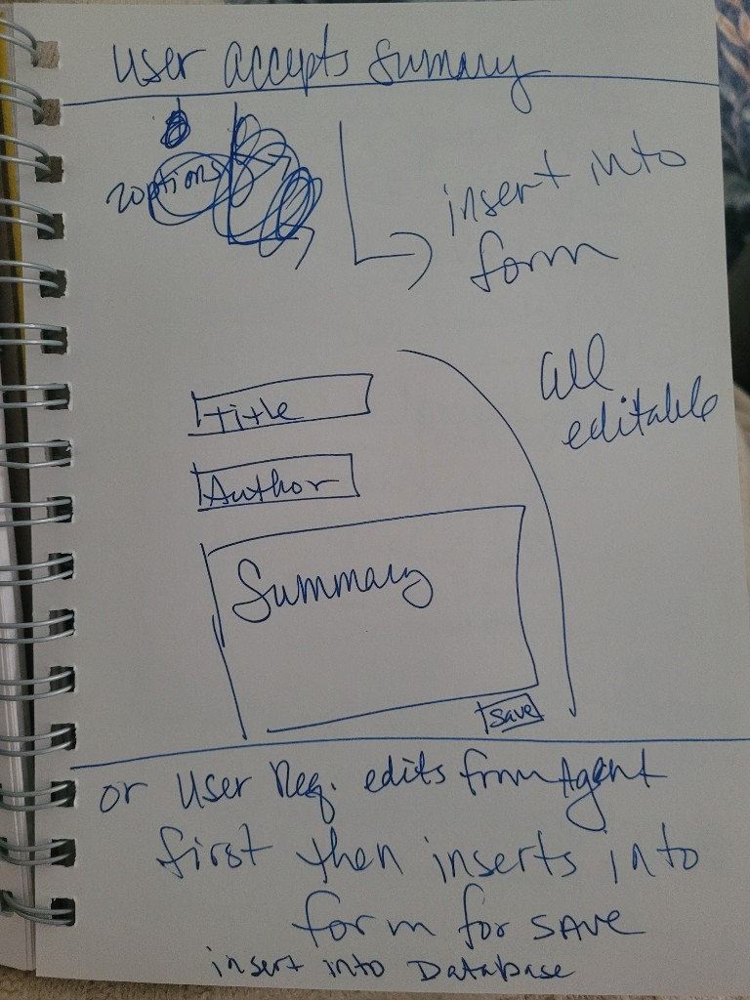
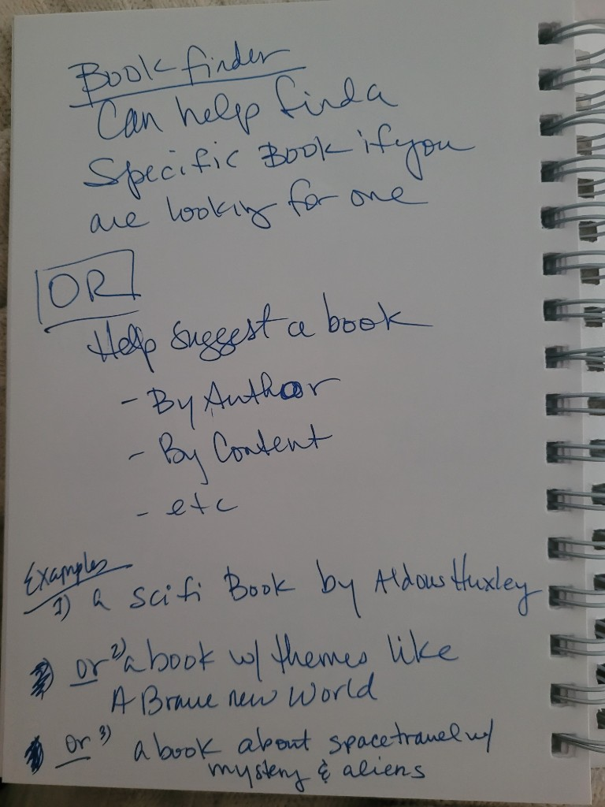
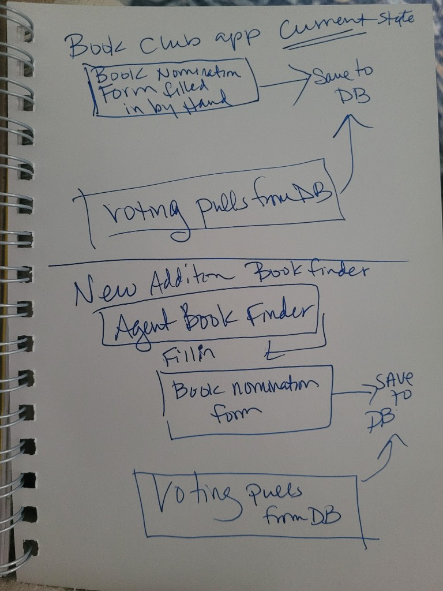
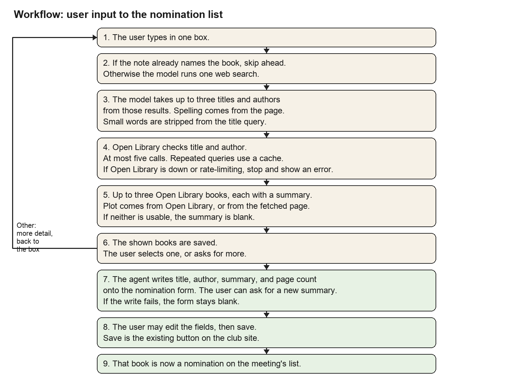

# ICS 603 Final Project Proposal

## Project goal

A book finder that helps a book club member nominate a book they have in mind, or a book of a type they like.

## Intended user and problem

The user is a member of my book club nominating a book for the next meeting. I already run the club’s web app. Add a Book fills the nomination form from Open Library only when the title or author is close to what the member types. A partial title, a misspelled author, or a description of the book does not find it. The form cannot suggest a type of book. When a record is found, its description is often missing, in another language, or wrong, so a voter cannot tell the books apart.

Find means the member has one book in mind. They can use the finder to fill the form even when they already know the title and author. Suggest means they have no particular book, only a type. One box takes either kind of input. The model chooses find or suggest, and asks if the input could be either. Today’s search covers only find, and only when the title or author is already close.

## Example input

> author’s name was greg something, the title had bear in it, and it was biology science fiction

The book is *Blood Music* by Greg Bear. “Bear” is the author’s last name, not a word in the title. A title search for “bear” does not return it. The finder should search the author.

## Sample input set

Rows 1–3 and 6 are realistic examples I can share. Rows 4, 5, 7, and 8 are synthetic. Rows 4 and 8 were checked against Open Library on October 16, 2026. No input names a person.

Shown books are Open Library records only, at most three, each with title, author, and a jacket summary. The summary does not give the ending, the twist, the culprit, or a death.

1. Realistic. Find. The example above. Expect *Blood Music*, Greg Bear, if an author search returns it. If it does not, ask for more. Do not offer a different book that only has “bear” in the title.
2. Realistic. Suggest. “a book with themes like Brave New World.” Expect books about a controlled society, such as *1984* or *Fahrenheit 451* when Open Library returns them. If none fit, ask for more.
3. Realistic. Suggest. “a sci-fi book by Aldous Huxley.” Expect *Brave New World* if Open Library returns it.
4. Synthetic, checked. Find. “a ship sinks, the author is erik larson.” Expect *Dead Wake*, Erik Larson. Those words as typed return nothing. A title-and-author search does.
5. Synthetic. Summary. Same input as row 8. If that record’s description is missing, not in English, or unusable, expect an editable English summary. It may say a murder happens on a train. It does not name the culprit. A usable description is still rewritten, not copied.
6. Realistic. Suggest. “a book about space travel with mystery and aliens.” Expect matching books, or a request for a narrower description.
7. Synthetic. Find. “the martian.” Expect *The Martian*, Andy Weir, when Open Library returns it. This is the case where the member already knows the book and uses the finder to fill the form.
8. Synthetic, checked. Find. “agatha something, murder on a train.” Expect *Murder on the Orient Express*, Agatha Christie.

## Expected result and value

The member sees up to three books, selects one, and gets title, author, summary, and page count on the nomination form. They can edit those fields. Page count stays empty when Open Library has none. Save adds the book to the list the club votes on.

The check against today’s work: the Greg Bear scrap that Add a Book misses ends as *Blood Music* on that list, and a voter can use the summary without rewriting it.

## Big-picture sketch

The paper photos are not numbered. These are the screen areas. `?` marks an open question.

1. One box for user input and agent response.
2. Up to three books selection returned to the user, or a request for more input. Each shows title, author, and  brief summary.
3. The member selects one book, or chooses Other, supplies more info and returns to the chat.
4. The agent writes the summary and presents it to the user for approval or iteration.
5. The member edits or accepts the summary. Title, author, and page count come from Open Library. The photo shows title, author, and summary. Page count is a fourth field on that form. The model does not invent it. `?` Where the plot comes from when Open Library’s description is unusable.
6. Agent writes the selected book info and agreed upon summary to the nomination form.
7. User clicks save, then the book is on the nomination list.

The next photo is a note of the goal, not a screen: find one book, or suggest one. The agent infers which the user intends. The last photo is the existing nomination form. Today the member fills it by hand. Version one fills it from the finder. 

## Workflow or component sketch

## Data source and access

There are two data sources. 

The first is Open Library, a public API with No key required. The model chooses the searches: a likely title and author, or words from the input. Fields used: title, author, subjects, description or first sentence, and page count when present.

There is also a local database which contains book information once a book is nominated and also retains voting information. 

Neither source is sensitive. 

## Up to three core features

1. An agent chatbox, which the model uses to turn the input into Open Library searches and keeps up to three options, or asks for more information.
2. Book summary generation. 
3. The member selects a book, edits title, author, summary, or page count, and saves it onto the nomination list the vote already reads.

## LLM role

First call. Input: the typed text and local nomination titles. Output: find or suggest, and one or more Open Library searches. If the input could be either, it asks. This call does not show a book.

Second call. Input: the Open Library records those searches returned. Output: up to three that fit, each with a one-line reason, or a request for more. It does not fill the form from memory.

Third call, once per kept book. Input: title, author, the typed text, and subjects when present. Output: the summary in the model’s own words, not a copy or a translation of Open Library. Page count is not an output of this call. Where the plot comes from when the description is unusable is open below.

## Data use

Look up Open Library for the searches the model chose. Compare those records with the typed text and with titles this finder already saved. Do not look up votes, accounts, or the voting database.

## Saved records

This finder’s database keeps three linked records after a restart.

- **Inquiry:** the typed text, the books shown, and whether the member selected one, chose Other, or stopped. It points at the works shown.
- **Work:** Open Library title, author, subjects, and page count when present.
- **Nomination:** created only on save. It points at one inquiry and one work. It stores title, author, page count when present, the summary after the member’s edit, and whether the post to the voting app succeeded.

The voting app’s nomination gains a page-count field. That row is written only by the existing add-book save, and only while the meeting is accepting nominations. Other creates no nomination. A failed post stays on this finder’s nomination.

## Searchable text

The approved summaries, and what the member typed.

## Human review

Save is the confirmation. Until then the member can edit the summary, title, author, and page count. Other, and a request for more, do not write a nomination. Title and author on the card are the Open Library record, so the member can check that the summary matches that book.

## One failure case

The form is filled in. The write fails becausxe the title or author is missing, or the meeting is not accepting nominations. The member sees the error. The book is not added. The selection stays for another save, without a new search. Books already on the meeting stay unchanged.

## Three acceptance criteria

1. Given “a ship sinks, the author is erik larson” during a meeting that is accepting nominations, when the member selects *Dead Wake* and saves, then the vote list gains *Dead Wake* by Erik Larson with the summary that was on the form.
2. Given the Greg Bear example, when the reply is shown, then *Blood Music* by Greg Bear is offered only if Open Library returned it. If not, the reply asks for more and does not offer a different book that only has “bear” in the title. Books already on the meeting stay unchanged.
3. Given a selected book and a meeting that is not accepting nominations, when the member saves, then the write fails, the selection stays, the book is not added, and books already on the meeting stay unchanged.

## Outside version one

Version one does not rebuild voting, accounts, or results. It is not a phone app. It does not write back to Open Library, scan a barcode, track reading, or run a discussion. It does not save a book the member did not select. It runs locally. A public site waits for Docker and cloud.

Later: look up a book the club already nominated, to nominate it again or only to read it, and look up the previous winning book. That reads the voting app. Names, emails, and vote counts stay out of the prompt.

## Open questions

Where does the summary’s plot come from when Open Library’s description is missing, in another language, or wrong? Title, author, and subjects do not contain it. The candidates are what the model already knows, a usable description that the model rewrites, or a web search.

## Next investigation

That source is the biggest uncertainty. Open Library and the course model can answer it.

For *Blood Music*, *Dead Wake*, and *Murder on the Orient Express*, record whether the chosen searches return the book, whether Open Library has one record or several, whether any record has a usable description, and whether a jacket summary is accurate without that description and without the ending.

If the model does not know the book and no record has a usable description, version one either allows a web search or shows the book with no summary until the member writes one.
